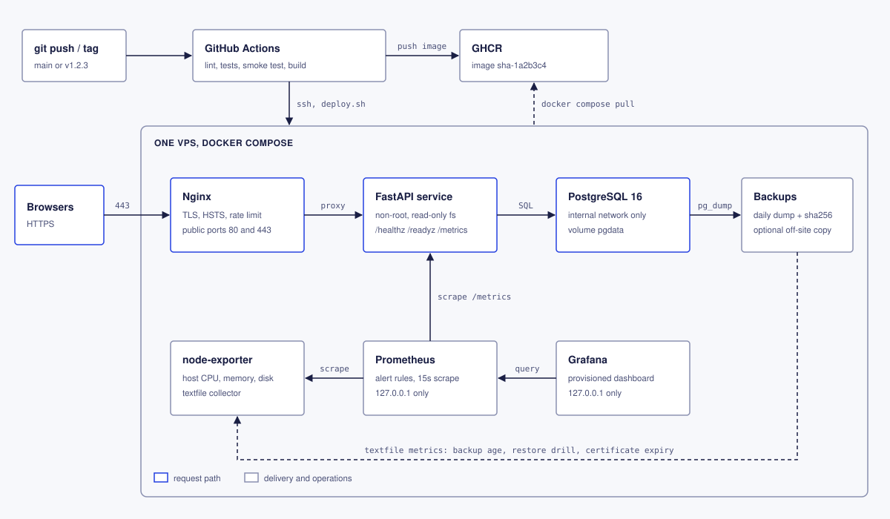
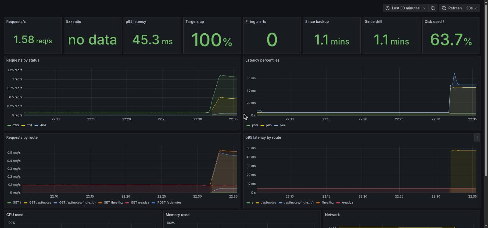

# production-deploy-reference

[](https://github.com/Zaeem-A/production-deploy-reference/actions/workflows/deploy.yml)

A small FastAPI service and everything around it that a production deployment needs: Docker, Nginx with
HTTPS, CI/CD with GitHub Actions, Postgres with migrations and tested backups, Prometheus and Grafana
with alerts, and the scripts and runbook to operate it on one server.

This is a reference setup, not a client project and not the Moqah.pk codebase. It uses the same building
blocks I work with there (Docker, Nginx and SSL, GitHub Actions, Prometheus and Grafana). The app is a
deliberately tiny notes API, so the deployment is the part worth reading.



## What is in it

| Area | What | Where |
|---|---|---|
| Service | FastAPI with liveness and readiness endpoints, Prometheus metrics per route, JSON logs, request IDs, non-root read-only container | `service/` |
| Edge | Nginx with TLS 1.2/1.3, HSTS, rate limiting and an HTTP to HTTPS redirect; `/metrics` is never public. Let's Encrypt with a placeholder-then-real certificate flow and daily renewal | `nginx/`, `scripts/init-tls.sh`, `scripts/renew-certs.sh` |
| Database | Postgres 16 on an internal-only network; forward-only SQL migrations under an advisory lock | `service/migrations/`, `service/src/notes_api/migrate.py` |
| Deploys | One script: pull, back up, migrate, start, check the new version is answering, put the previous image back if it is not | `scripts/deploy.sh`, `scripts/rollback.sh` |
| CI/CD | Lint and tests against real Postgres, then a full-stack smoke test. Pushes to `main` publish an image to GHCR; once a server is configured they also deploy to staging, and `v*` tags deploy to production behind optional approval | `.github/workflows/` |
| Backups | Daily dump with integrity check, checksum, retention and optional rclone off-site copy; monthly restore drill; restore over the live database behind a typed confirmation | `scripts/backup.sh`, `restore.sh`, `restore-drill.sh` |
| Monitoring | Prometheus, node-exporter and a provisioned Grafana dashboard. Alerts for target down, errors, latency, disk, memory, CPU, stale backups, stale restore drills and certificate expiry | `monitoring/` |
| Docs | Runbook (setup, deploy, rollback, restore, failure modes), design decisions, and a [sample deploy checklist report](docs/SAMPLE-DEPLOY-CHECKLIST-REPORT.md) showing the review format | `docs/` |

## Try it locally

Needs Docker with Compose 2.24 or newer and bash 4.4 or newer, on Linux (node-exporter mounts the host
filesystem with `rslave`, which Docker Desktop does not support; the rest works there).

```bash
cp .env.example .env
make secrets tls up
curl -k https://localhost/healthz
```

If ports 80 and 443 are taken, set `HTTP_PORT=8080` and `HTTPS_PORT=8443` in `.env` first and use
`https://localhost:8443`.

Grafana is at `http://127.0.0.1:3000` (user `admin`, password in `secrets/grafana_admin_password`) and
Prometheus at `http://127.0.0.1:9090`. `make help` lists the other targets. To run it on a real server
with a real domain, follow `docs/RUNBOOK.md`.


*The provisioned dashboard after a short load run, a backup and a restore drill.*

## Troubleshooting

**`curl` says connection refused, or `make up` starts but nothing answers on port 80.**
Another service (Apache, another Nginx, a dev server) already holds port 80 or 443, so Docker
cannot publish them. Check with `sudo ss -ltnp | grep -E ':(80|443)\b'`. Either stop that service or set
`HTTP_PORT=8080` and `HTTPS_PORT=8443` in `.env`, run `make up` again and use
`https://localhost:8443`.

**Backup and restore-drill panels show "no data" and the stale-backup alert fires.**
The scripts publish their metrics to `METRICS_TEXTFILE_DIR` (default
`/var/lib/node-exporter-textfile`). If that folder does not exist or is not writable by your user, the
scripts still succeed but log a `WARN ... metric not published`, and node-exporter has nothing to read.
For a local run, set `METRICS_TEXTFILE_DIR=$PWD/data/textfile` in `.env`, run `make up` again, then
`scripts/backup.sh` and `scripts/restore-drill.sh`. The panels fill in after the next Prometheus scrape.

## How it is tested

- **`pytest` in `service/`**: configuration, logging, the store, API behaviour, and the migrations and
  queries against a real Postgres (CI runs a Postgres service container).
- **`scripts/tests/test-deploy-flow.sh`**: `deploy.sh` and `rollback.sh` against a fake `docker compose`
  that records calls and injects failures. Covers step order, the pre-deploy backup, automatic rollback
  when a release fails to start or never answers, a failing migration leaving the running version alone,
  a failing backup blocking the deploy, and bad input being refused.
- **`scripts/smoke-test.sh`** (the "Full stack smoke test" CI job): builds the image and starts the real
  stack, deploys twice, rolls back, takes a backup, restores it into a scratch database, then restores
  it over the live database, checking through Nginx after each step that the data survived. It also
  checks that Prometheus scrapes every target and loads the alert rules, that the backup, restore-drill
  and certificate metrics reach Prometheus, and that every Grafana panel query is valid PromQL.
- ShellCheck runs over all scripts in CI.

Not covered by CI: Let's Encrypt issuance and the SSH deploy job, because both need a real domain and
server. They follow the steps in the runbook.

## Left out on purpose

Kubernetes and multi-node failover, provisioning the server itself (Terraform or Ansible), Alertmanager
routing (alerts show up in Prometheus until you add a receiver), log aggregation, a secrets manager, and
blue-green or canary releases. `docs/DECISIONS.md` explains the choices that were made instead.

## Layout

```
compose.yaml          the stack
.env.example          settings; copy to .env
Makefile              shortcuts, see `make help`
service/              FastAPI app, migrations, Dockerfile, tests
nginx/templates/      Nginx config, rendered from APP_DOMAIN at container start
monitoring/           Prometheus config and alerts, Grafana provisioning and dashboard
scripts/              deploy, rollback, backup, restore, TLS, smoke test
scripts/tests/        deploy and rollback tests against a fake docker compose
.github/workflows/    CI and build-and-deploy
docs/                 RUNBOOK.md, DECISIONS.md, SAMPLE-DEPLOY-CHECKLIST-REPORT.md, architecture.svg
```

## Licence

MIT, see `LICENSE`.
